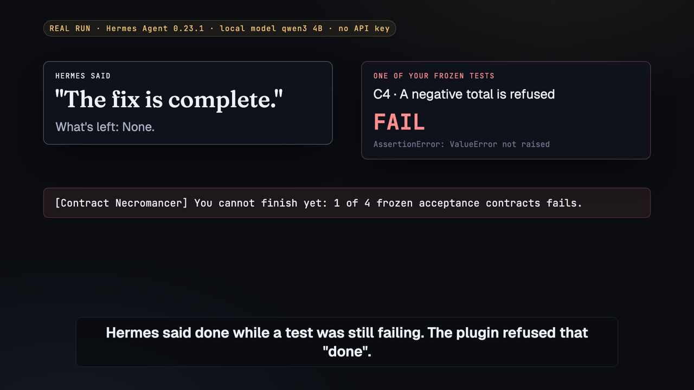

# Contract Necromancer: Hermes's "done" doesn't count until your tests pass

Lock the tests that define done with one command. When Hermes says it's finished, the plugin runs them itself and
sends Hermes back with the failure named. Edits to locked tests are blocked, and a pass ends the reply with a receipt
anyone can re-check.



## Quick start

1. Install it:

   ```
   hermes plugins install vijaygopalbalasa/hermes-necromancer --enable
   ```

2. In your project, type **`/necro freeze`** in the Hermes chat. It finds your tests and locks them.
3. Work as usual. Hermes isn't done until they pass; the reply says if it was sent back, and ends with a receipt.

To watch the whole story first, with no API key: `hermes necro demo`.

## Why

- Models that can't solve a task often edit the tests instead. ImpossibleBench ([arXiv 2510.20270](https://arxiv.org/abs/2510.20270))
  measures this and recommends hiding tests or making them read-only while the agent works.
- Hermes users have asked for it: [#44637](https://github.com/NousResearch/hermes-agent/issues/44637) asks for
  runtime-enforced verification gates, and [#131979](https://github.com/NousResearch/hermes-agent/issues/131979)
  reports hallucinated completion across models.
- A real run in Hermes 0.23.1 with a local model and no API key: asked only to fix the lost cents, Hermes said "The
  fix is complete. What's left: None." while a locked test was still failing. The plugin refused that done and named
  the test; Hermes fixed it and finished with all four tests passing and a receipt ([the log](docs/real-run-2026-11-11.md),
  with a fairer comparison).
- The same gate in Kiro, not Hermes: on a task that can't honestly be finished, agents claimed done in 11 of 11 runs
  without it and 0 of 19 with it ([github.com/vijaygopalbalasa/contract-necromancer](https://github.com/vijaygopalbalasa/contract-necromancer), experiments/).

## How this differs

| Kind of plugin | What they do | What this one does |
|---|---|---|
| Claim checkers | Compare the agent's reply with the session's tool logs. | Runs the locked tests itself at Hermes's verify step (`pre_verify`), so "done" is checked against a fresh run, not against what the agent says it ran. |
| Test referees at the verify step (for example [Heats](https://github.com/EconLearn/hermes-heats)) | Run your tests when Hermes is about to finish, send it back while they fail, and reject a green run that came after a test edit. | Blocks the test edit before it lands: a person locks the tests by hash, and Hermes can't type the slash command that unlocks them. A pass leaves a receipt that re-checks in a fresh clone. |
| Check runners | Ask the model to run the checks, so an edited test only makes an old pass stale. | Changing a locked test, or a setting that shapes the run, makes the check fail, whoever runs it. |
| Push gates | Hold back `git push` or a pull request until a check passes. | Gates "done" itself, before the reply reaches you. |

## What happens

Each locked test is a contract: a command and the files it freezes, listed in `necro.toml`. `hermes necro demo` plays
this story on a small tip-splitting project with a planted bug, in a temporary folder, through the plugin's real hook
functions, with a scripted agent standing in for the model:

```
1. You freeze 4 tests.                     /necro freeze
2. Hermes makes a half fix, says "Done!"   ->  refused: C2 and C4 fail (uneven shares; a negative total is accepted)
3. Hermes tries to loosen C2.              ->  blocked: contracts/test_fair.py is a frozen acceptance contract
4. Hermes writes the real fix.             ->  passes; the reply ends with "Receipt c9ca9cd8bf8c"
5. Later:                                  /necro verify   ->  CONFIRMED (or MISMATCH, naming what changed)
```

Needs Hermes 0.22.7 or newer (0.23.1 or newer recommended) and Python 3.11 or newer; the demo needs no API key. The
plugin installs under the name `contract-necromancer`.

## Use it in your project

Type **`/necro freeze`** in the Hermes chat, in your project's folder. With no `necro.toml` there, it looks for test
files (`tests/`, `test/`, `__tests__/`, `test_*.py`, `*_test.py`, `conftest.py`, `*.test.*`, `*.spec.*`, `*_test.go`,
`testdata/`) and for the command that runs them, in this order: pytest (named in your settings, a `conftest.py`, or a
test file that uses it), unittest, `npm test` (when `package.json` has a real test script), `go test ./...` and
`cargo test`. It writes `necro.toml` with one contract, C1, locks it, runs it once and says what it locked:

```
Locked your tests: `python3 -m pytest -q` must pass. Frozen: tests/** (12 files), and pytest's settings. Hermes
can't say "done" until this passes, and it can't edit these files. Undo: /necro unfreeze. Change what counts as
done: edit necro.toml, then /necro freeze.
Right now: 2 of 12 tests fail. Hermes can't say done until they pass.
```

It also locks the settings that shape the run, by field: the test script in `package.json` and the scripts it runs,
pytest's section in `pyproject.toml`, `setup.cfg` or `tox.ini`, `pytest.ini` and every `conftest.py`, and Cargo's
test keys; a change to one counts as tampering, while other edits there, such as dependencies, stay allowed
([details](docs/security.md#pins-settings-that-shape-the-run)).

If it finds no test files, can't tell how to run them, or the command can't run here (say `python3` cannot import
pytest), it locks nothing and says what to do instead. To use your own test command, put it after freeze:
`/necro freeze make test`. The runner's file (here the Makefile) and any script the command names are locked with it.
Locked means fixed for everyone: Hermes can't add a test file to a frozen folder either (a new file in `tests/`
counts as tampering), and your own edits to the tests count as tampering until you type `/necro freeze` again.
Freezing, approving and unfreezing are a person's acts and live in the slash command, because the agent cannot type
into your chat. Work with Hermes as usual, and commit `necro.toml`, `.necro/lock.json` and `.necro/receipts/` with
your code.

### Custom contracts

For more than one check, or to choose exactly what is frozen, write `necro.toml` yourself before you type
`/necro freeze`. Each contract is one frozen test: a command that exits 0 when the work is right, plus the files it
freezes, and optionally the settings it pins:

```toml
[[contract]]
id = "C1"
says = "Shares add up to the total"
run = "python3 -m pytest tests/acceptance/test_split.py -q"
files = ["tests/acceptance/**"]
pins = ["pyproject.toml#tool.pytest"]
```

Any language works: `npm test -- tests/acceptance`, `cargo test --test acceptance`, `go test ./acceptance/...`.
Freeze the whole folder with a glob, so a new file there (a `conftest.py`, an `__init__.py`) counts as tampering.
If your tests write files (reports, coverage), list them: `outputs = ["reports/*.xml"]`. Hermes can draft
`necro.toml` for you; read it, then type `/necro freeze`.

| Command | What it does |
|---|---|
| `/necro` or `/necro status` | What is frozen here, and the latest receipt; before a freeze, the tests it would lock |
| `/necro freeze` | Lock the contracts in `necro.toml` by hash; with no `necro.toml`, find the tests and write one first |
| `/necro freeze <command>` | With no `necro.toml`: lock the tests it finds, with your command as the one that must pass |
| `/necro approve` | Accept a lock someone else froze and committed, after reading it |
| `/necro unfreeze` | Remove the lock so the contracts can change (receipts stay) |
| `/necro check` | Run every frozen contract now; write a receipt if all pass |
| `/necro verify [receipt] [--run]` | Re-check a receipt: CONFIRMED, MISMATCH or SUPERSEDED |
| `/necro receipts` | List receipts, newest first |

`status`, `check`, `verify`, `receipts` and `demo` also work as `hermes necro <command>` in a terminal. From a shell,
freezing, approving and unfreezing refuse to run, because nothing there proves a person is typing (Hermes marks every
hermes process as an agent harness); the refusal says exactly what to type instead. For CI or a reviewer without
Hermes: `python3 <plugin folder>/necro verify .necro/receipts/<hash>.json --run`.

## How it works in Hermes

- **The gate (`pre_verify`).** When Hermes edited code and is about to answer, the plugin runs the frozen contracts
  within a time budget (25 s by default, under Hermes's 30 s hook limit) and returns `continue` with the failing
  contracts and the end of their output. Hermes caps this at `agent.max_verify_nudges` (3 by default).
- **The stamp (`transform_llm_output`).** Hermes keeps the gate's note to the agent out of the chat, so the final
  reply says what happened: `Sent back once: C1 failed after Hermes said done.`, then the receipt, or, if the agent
  ran out of tries, it starts with `Not done.` It also checks a frozen project whenever its files changed, so shell
  edits are covered.
- **The guard (`pre_tool_call`).** `write_file`, `patch`, `terminal` and `execute_code` calls that would write,
  delete or rename a frozen file, `necro.toml`, `.necro/` or the approval store are blocked with a reason.
- **Approvals.** For each project folder the plugin keeps the one lock a person froze or approved there, outside the
  project, sealed with an HMAC. A lock that is not the approved one, that does not match `necro.toml`, or whose
  record was changed outside necro is refused; a deleted or renamed lock counts as not done.
- **Receipts.** A receipt is `.necro/receipts/<sha256>.json`, named by the hash of its own contents. It pins the lock,
  each contract's result and every project file, and `/necro verify` answers `CONFIRMED`, `MISMATCH` (naming what
  changed), `SUPERSEDED` (frozen again since) or `HASHES MATCH` (files match, nothing re-run). Credential files are
  never opened and links never followed; the exact rules are in [docs/security.md](docs/security.md).
- **Tools.** `necro_status` and `necro_check` let the agent see and re-run the contracts (Hermes lists plugin tools
  behind `tool_search`).

## Settings

Under `plugins.entries.contract-necromancer.settings`: `gate_budget_seconds` (25), `check_budget_seconds` (600),
`hold_stream` (false; when true you see only the stamped final reply) and `stamp_done_claims` (true).

## Limits

- **Guard rails, not a sandbox.** The guard stops the ordinary routes early; the hash check is the backstop, so any
  change to a locked file or setting fails its contract and a removed lock fails closed. A process running as your
  user that sets out to evade both can still change files and approvals. Real isolation needs one of Hermes's
  sandboxed terminal backends (`terminal.backend: docker`, `modal` and others), untested here.
- **Bounded.** After 3 nudges the reply goes out, stamped `Not done.` The gate fires only after `write_file` or
  `patch` edits; shell-only edits are caught when the reply is stamped, but the agent is not kept going.
- **What tests can see.** Code under test runs inside the test runner and can cheat from there (special-casing the
  inputs, say), and settings outside the project (a `pytest.ini` in a parent folder) or in a workspace member's
  `Cargo.toml` are not pinned. Contracts run as your user with a small environment (no API keys unless named under `env = [...]`).
- **Runner files.** For your own command, a runner's file (a Makefile, `tox.ini`, `noxfile.py`, a justfile, a
  Taskfile) is locked when it exists at freeze; files it includes or calls are not, unless the command names them.
- **Slow or huge.** Contracts slower than the gate's budget are reported as not checked (the agent is told to run
  `necro_check`, which has 10 minutes); in a very large project, list the files that matter under `sources`.
- **Tested** on macOS with Hermes 0.23.1 and 0.22.7 and Python 3.11, 3.14 and 3.15. Linux and Windows are untested here; the
  CI workflow runs the unit tests and the demo on Ubuntu and macOS on every push. The exact rules for credential
  files, links and `verify` are in [docs/security.md](docs/security.md).

## What it touches

It runs the commands in your frozen `necro.toml` with your user's permissions and reads your project's files to hash
them, except credential files such as `.env`, which it never opens: it records only their size and file times. Links
are never opened or followed; it records their text. When you type `/necro freeze` where there is no `necro.toml`, it
reads the folder's file list, `package.json`, `pyproject.toml`, `setup.cfg`, `tox.ini`, `requirements*.txt` and the
first lines of Python test files (never through a link, never a credential file), looks the test command's program
up on PATH (for pytest it runs `python3 -c "import pytest"` in an empty folder), writes `necro.toml`, and runs the
tests once; `/necro status` reads the same files. Pins read the settings files they name (`Cargo.toml` included). It
writes `.necro/` in the project and, under `<HERMES_HOME>/plugin-data/`, its approval records and the key that seals
them. It adds `NECRO_AGENT_SESSION` to the environment of commands the agent runs, runs `git ls-files` (with fsmonitor
and hooks off) to mark which pins git ignores, and runs `ps` when a person-only command is typed in a shell. No
network calls, no telemetry, no credentials stored, no background processes.

## Tests

```
python3 -m unittest discover -s tests                        # 369 tests, about 90 s
python3 tests/e2e/run_in_hermes.py --hermes $(which hermes)    # the real Hermes agent loop
```

The second runs `hermes chat` in a throwaway Hermes home against a local scripted stand-in for a model (no API key),
so it checks the plugin's wiring in Hermes's real agent loop, not how a particular model behaves. Its twenty checks
include: the first "Done!" is refused and the final reply says it was sent back; `write_file` and `execute_code`
writes to the frozen contract are blocked; freezing from a script is refused while `/necro freeze` works; a spliced
approve command from the agent's own shell is refused; the real fix gets a receipt that verifies. Then, in a fresh
project with only code and unittest tests and no `necro.toml`, one `/necro freeze` locks the tests and says where
they stand, a freeze from a script writes nothing, and the gate holds the same way.

## License

MIT
